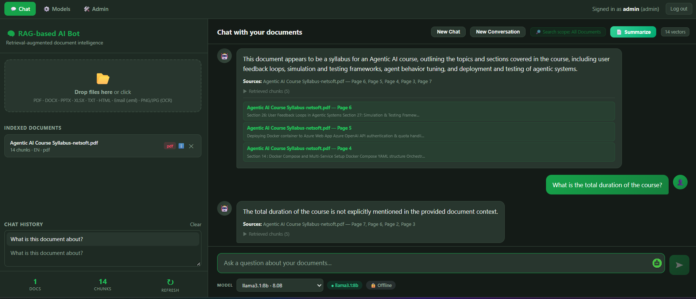
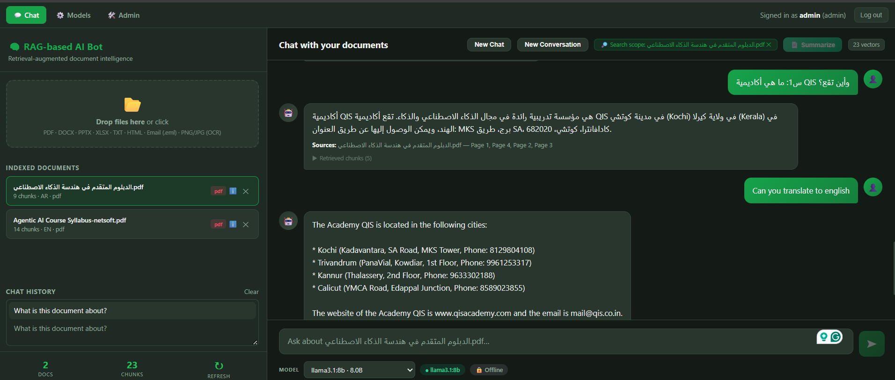
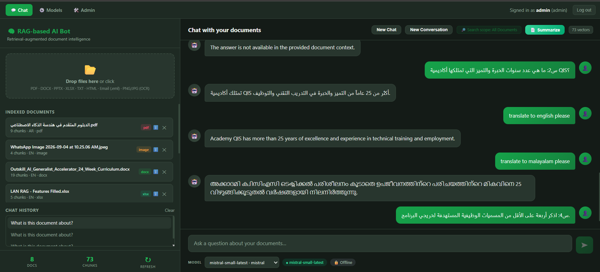
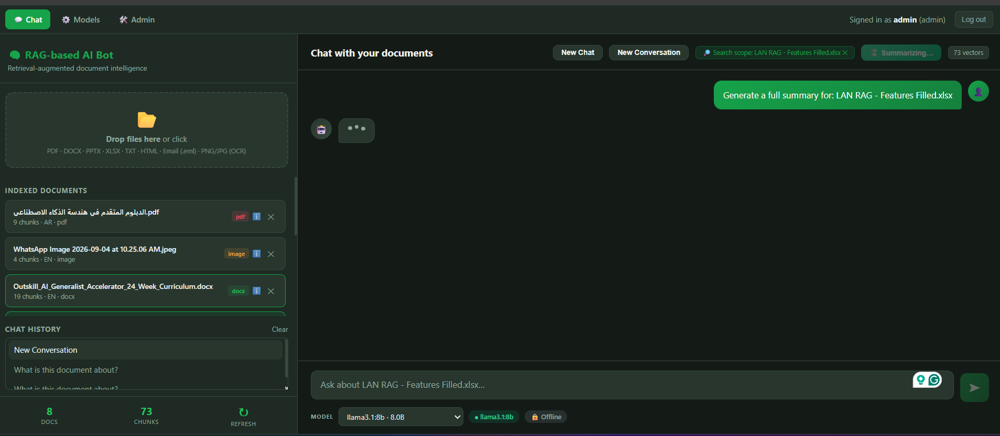

# RAG-Based AI Bot 🤖

**A multi-user, offline-first document intelligence platform.** Upload your files, chat with them in English, Arabic or Malayalam, and choose which LLM answers — local models by default, or cloud models when you explicitly go online. Every answer is grounded in the user's own documents and cited to the page.

   ## 🎬 Project Demo
   

https://github.com/user-attachments/assets/b6f47026-ee75-4fcc-b0a9-862d43c5cade

> 🔒 **This is a project showcase.** The source code is in a private repository and is available to hiring teams on request (see [Contact](#-contact)).

---

## ⭐ Main Features

| | Feature | Highlights |
|---|---|---|
| 🌍 | **Multilingual** | English, Arabic & Malayalam — ask in any, switch mid-conversation, and the bot follows. |
| 📂 | **Multi-file, multi-format upload** | PDF, DOCX, TXT, PPTX, XLSX, HTML, EML and images (OCR), several at once. |
| 🔀 | **Multi-LLM, interchangeable** | Local and cloud models behind one provider layer; switch live from the chat UI. |
| 🔐 | **User authentication** | Secure token-based sessions and hashed passwords. |
| 🛡️ | **Role-based access control** | Separate admin and user roles. |
| 📍 | **Source citations** | Answers point to the page, slide or sheet they came from. |
| 🎯 | **Scope-based chat** | Chat with one document, several selected documents, or the whole document set. |
| 💬 | **Chat history** | Persistent per-user conversations, restored on reload. |
| 🏢 | **On-premise & private** | Model, embeddings, vector store and data all run on your own infrastructure; nothing is used for training. |

### 🌍 Multilingual — English, Arabic & Malayalam
- Multilingual embeddings, so a question in one language can retrieve from documents in another.
- Per-question language detection; the answer comes back **in the language of the current question**, even after a mid-conversation switch.
- A dedicated **Malayalam pipeline** (script detection, Unicode normalization, OCR for scanned documents) and **Arabic OCR** support.
- Summaries and suggested questions are written in the document's own language.

### 📂 Multiple file upload, many file types
- Upload several files at once: **PDF, DOCX, TXT, PPTX, XLSX, HTML, EML** and **images (OCR)**.
- **Live per-file status tracking** — a failed file is reported immediately instead of blocking the rest of the batch.
- **Table-aware PDF extraction** keeps the row structure of tables.
- Garbled text is detected and automatically falls back to OCR.

### 🔀 Multi-LLM with live switching
- Pluggable provider layer supporting **local models (Ollama)** and **cloud models (Mistral, OpenAI, Gemini)**.
- Switch the active model from the chat UI, even mid-conversation; the next reply uses it.
- The model behind every answer is **recorded in the chat history**.
- In the default offline mode, cloud providers are blocked — there is no silent cloud fallback.

### 🔐 User authentication
- Token-based login with securely hashed passwords.
- Self-registration and session management.

### 🛡️ Role-based access control
- **Admins** manage users, view platform statistics and control which models are active.
- **Users** get a private workspace: their own files, vector index and conversations.

### 📍 Source citations
- Answers are grounded only in retrieved content and cited to the **page** (PDF), **slide** (PPTX) or **sheet** (XLSX).
- Documents are scoped per conversation, so citations never leak across unrelated chats.

### 🎯 Scope-based chat
- Choose what the bot searches: a **single document**, **multiple selected documents**, or the **whole document set** in the conversation.
- Retrieval and citations stay inside the chosen scope, so answers never mix in unrelated files.
- Follow-up questions such as "how many modules does it have?" stay on the document you were just discussing.

### 💬 Chat history
- Conversations are stored per user and restored on reload.
- *New Chat* clears messages but keeps the documents; *New Window* starts a fresh workspace.

### Also included
- 🔒 **Per-user & per-conversation data isolation** — separate storage and vector index for every user.
- 🧭 **Intent routing** — small talk never triggers document retrieval.
- 📝 **On-demand summaries, document overviews and suggested questions**.
- ⚡ **Streaming responses** with a clear "model busy" signal instead of silent hangs.
- 🐳 **Docker-based deployment** (app + local LLM runtime).

---

## 📸 Screenshots

**Grounded answers with page-level source citations and the retrieved chunks behind them**

**Arabic document Q&A scoped to one selected document, then translated to English on request**

**Multilingual conversation: ask in Arabic, follow up with translations into English and Malayalam**

**Mixed file types (PDF, image via OCR, DOCX, XLSX) indexed together, with one-click summarize of a scoped document**

---

## 🔒 Data Privacy & On-Premise Deployment

Teams choose RAG over public AI tools when their documents are **sensitive**: contracts, HR records, legal, financial, medical or government files. This bot is built for that case. The whole pipeline runs inside your own infrastructure, so your data stays yours.

### Offline by default
- The default `offline` mode keeps every document, question and answer on the machine.
- The LLM runs locally through **Ollama** (default `llama3.1:8b`). No cloud API is called.
- The multilingual embedding model (`BAAI/bge-m3`) also runs locally, and the embedding libraries are forced into offline mode so even model loading cannot reach the internet.
- **No silent cloud fallback.** If a cloud model is selected while offline, it is ignored, a warning is logged and the local model answers.

### On-premise architecture
- Every component runs on your hardware: backend API, web frontend, database, FAISS vector store and the local LLM runtime.
- Shipped as **Docker Compose**, so it can be deployed on a company server, a private network or an air-gapped machine.
- No third-party SaaS or hosted vector database is needed at runtime.

### Your data stays under your control
- Uploaded files, extracted text, embeddings and chat history are stored on your own disk.
- Deleting a document removes the file, its vector chunks and its database record together.
- **Never used for training.** Local models only run inference and nothing is sent to a model provider, so your documents cannot be used to train anyone's model.

### Isolation and access control
- Token-based sessions, hashed passwords, and separate admin and user roles.
- Each user has their own storage and vector index. Isolation is enforced at the storage level, not just by query filters.
- Documents are scoped **per conversation**, so answers only draw on the files in that chat.
- Uploads are hardened against path traversal, and secrets are kept out of version control.

### Why it matters
- **Data residency:** data stays on your premises or in your country, supporting local data-protection rules and internal IT policies.
- **Predictable cost:** no per-query API fees and no dependence on a vendor's uptime.
- **Grounded answers:** responses come only from your documents, with page-level citations.

> **Online mode is an explicit opt-in.** Only an administrator can enable it, and only then do cloud providers (Mistral, OpenAI, Gemini) receive the question and retrieved document text. Keep offline mode for confidential data.
>
> **Hardware note:** on CPU-only machines a typical answer takes about 25–35 seconds. A GPU server makes on-premise deployment much faster.

---

## 🛠️ Tech Stack

| Layer | Technology |
|---|---|
| Backend | Python 3.11, FastAPI, Uvicorn, Pydantic v2, SQLAlchemy 2 |
| Auth & security | JWT, bcrypt, role-based route guards |
| LLMs | Ollama (local, e.g. Llama 3.1 8B), Mistral, OpenAI, Gemini |
| Orchestration | LangChain |
| Embeddings | BAAI/bge-m3 (multilingual) via sentence-transformers, PyTorch (CPU) |
| Vector store | FAISS, one index per user |
| Document processing | PyMuPDF, python-docx, python-pptx, openpyxl, BeautifulSoup |
| OCR & language | Tesseract (Malayalam, Arabic, English), EasyOCR, langdetect, indic-nlp-library |
| Frontend | React 18 single-page UI |
| Deployment | Docker & Docker Compose |

---

## ✅ Engineering & Quality

- **Structured UAT:** a 30-case user-acceptance register run end-to-end against a live backend; the gaps it found were fixed or mitigated and re-verified.
- **Security hardening:** found and fixed a path-traversal vulnerability in file upload during testing.
- **Regression suite:** 20 API- and browser-level checks covering all fixes, passing against a freshly restarted backend.
- **Reproducible builds:** exact-pinned ML dependency stack so Docker builds behave the same as the development environment.
- **Honest performance profiling:** benchmarked multiple local models and settings on CPU-only hardware, and kept the one that produced correct answers rather than the fastest.

---

## 🧩 Challenges & Solutions

| Challenge | Root cause | What I did |
|---|---|---|
| **Slow responses and slow document upload** | Local LLM and embedding inference runs on CPU-only hardware, and large documents mean a lot of text to embed and index. | Profiled the pipeline, benchmarked several local models, and tuned prompts and generation limits. Kept the model that gave correct answers rather than the fastest, and added a clear "model busy" response instead of silent hangs. **Recommended solution:** integrate a dedicated GPU to speed up both generation and embedding. |
| **Online/offline LLM switching failed silently** | The automatic fallback to the local model hid cloud failures such as exhausted token credits or no internet access, so the system appeared not to switch. | Traced it through the logs, API credentials and token usage, then fixed the switching behaviour and made provider failures visible instead of silently masked. |
| **Arabic and Malayalam text came out wrong** | The OCR and text pipeline lacked proper language support for these scripts. | Researched the problem and integrated Tesseract (via pytesseract) with the Arabic and Malayalam language packs, plus script detection and Unicode normalization. |

---

## 💡 How It Works

1. Sign in — workspace, files and vector index are private to the user.
2. Upload one or many documents; each is extracted (with OCR where needed), chunked, embedded and indexed.
3. Ask a question in English, Arabic or Malayalam; an intent router decides whether it needs the documents at all.
4. Relevant passages are retrieved from the documents in scope for that conversation.
5. The selected LLM answers in the question's language, with page-level citations.
6. The exchange is saved to chat history, tagged with the model that produced it.

---

## 📬 Contact

Built by **Asna Sherin** — AI Automation Specialist | Agentic AI Engineer | Claude Expert
[Email](mailto:assumay@gmail.com) | [LinkedIn](https://www.linkedin.com/in/asnasherinep/) | [Portfolio](https://asna-sherin.vercel.app/)

Source code and a live walkthrough are available to hiring teams on request.

## 📄 License

© 2026 Asna Sherin. All rights reserved — see [LICENSE](LICENSE).
